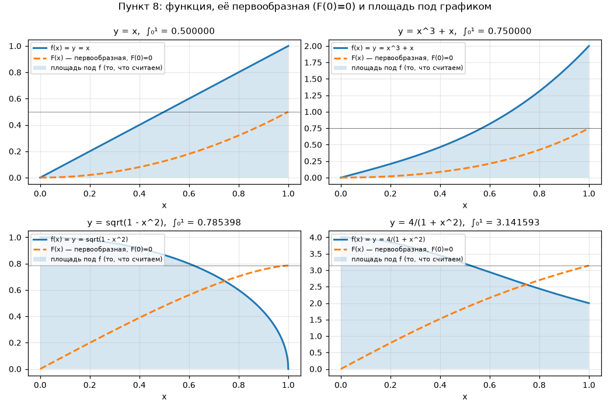
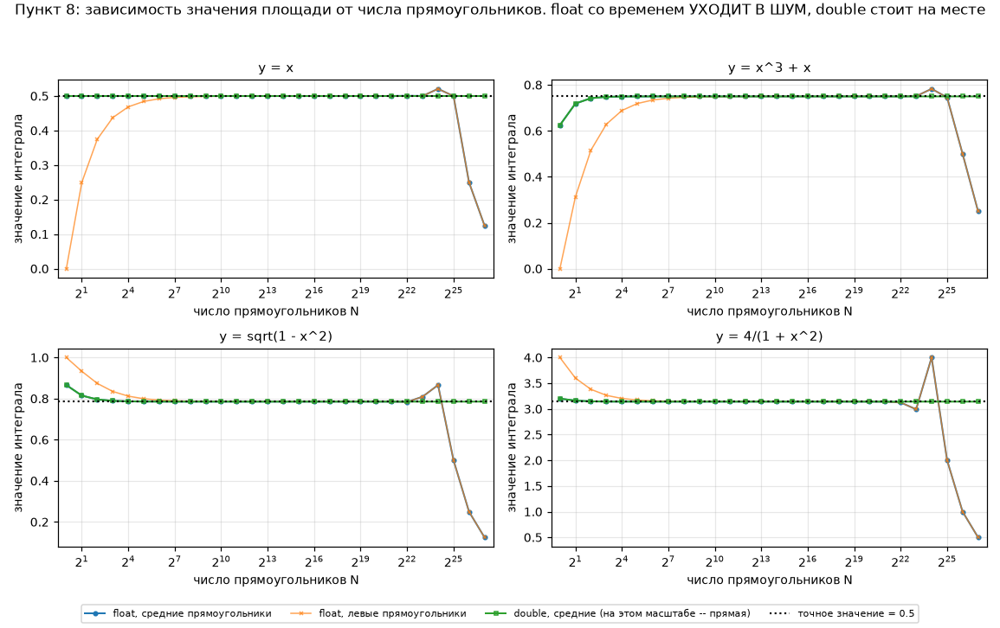
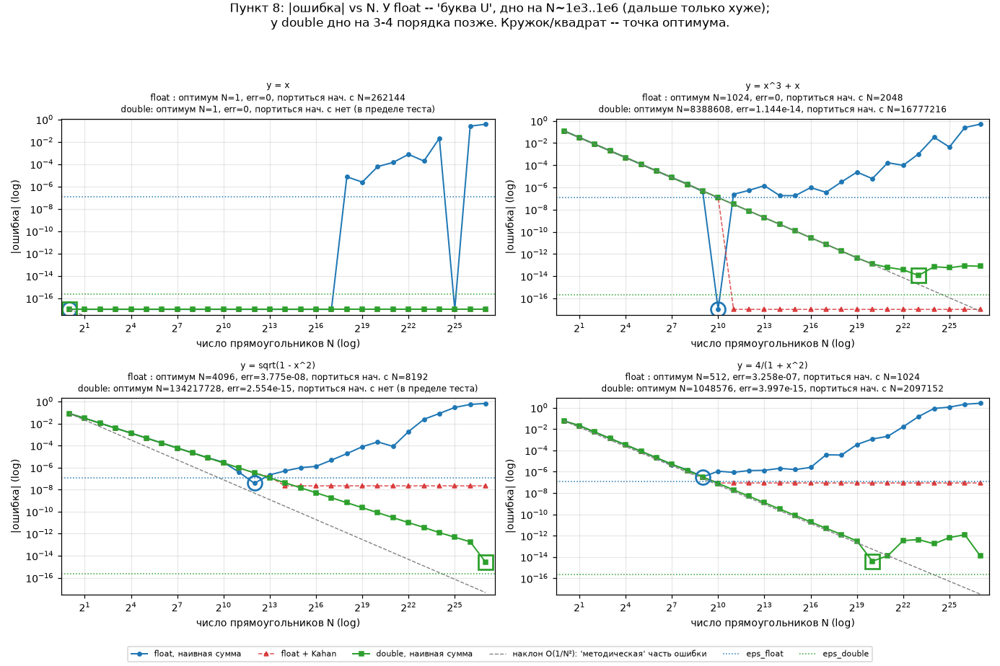

# Лаба по флоатам: анатомия и «судмедэкспертиза» IEEE 754

Отчёт по лабораторной работе «Лаба по флоатам» (первая арка — анатомия `float`,
вторая арка — судмедэкспертиза). Всё, что здесь есть, — собственный код и
собственные замеры, полученные прогоном этого кода.

**TL;DR (что реально удалось пощупать)**

| # | наблюдение, полученное на своей машине |
|---|---|
| 0 | `std::pow(3.0f, 16.0f)` возвращает `43046720`, а не `43046721`: float уже не может записать это целое |
| 0 | `std::pow(3.0, 34.0)` (`double`) возвращает `16677181699666570`, а правило «к ближайшему, при ничьей — к чётному» требует `16677181699666568`. Т.е. библиотечная `pow` не просто «теряет точность» — она ещё и **округляет не туда** |
| 2 | `0.2f` в памяти — это ровно `0.20000000298023223876953125` |
| 5 | цикл `for (float x = 0; x < 1e30f; x += 1.0f)` на моём компьютере зависает навечно на `x = 16777216 = 2^24` |
| 6 | сумма `1e7` штук `0.1f`, посчитанная в `float`, даёт `1087937` вместо `1000000.014901` (ошибка ~8.8% — потеряно ~880 000 слагаемых) |
| 7 | из 4913 троек «круглых» чисел скобки меняют ответ в 506 случаях (10.3%); сумма одного и того же массива из 1 000 000 чисел зависит от порядка сложения на 852 |
| 8 | оптимум метода прямоугольников для `float` — `N = 4096` (ошибка `3.8e-8`), после `N = 8192` уточнение сетки **ухудшает** ответ, а к `N = 2^27` ошибка — 0.66 (84% ответа). Для `double` дно на 3–4 порядка позже |
| 8 | «накапливать узел `x += h` нельзя» — при `N = 2^k` разницы нет вообще, 0 бит; рецепт оживает только при неточном `h` |
| 7.0 | `0.1f + 0.2f == 0.3f` — **равны** (оба `0x3E99999A`); «не равны» начинается с `double` |
| ★ | собранный с `-ffast-math` тот же самый код «чинит» неассоциативность (0 из 4913), ломает суммирование Канаана и врёт про `isfinite(inf)` — см. бонус-раздел «рецепты устаревают» |

---

## Окружение и воспроизводимость

```
$ g++ --version
g++ (Debian 12.2.0-14+deb12u1) 12.2.0
$ uname -m
x86_64
```

Сборка: `g++ -std=c++17 -O2 -Wall -Wextra` (флагов `-ffast-math`/`-march` по
умолчанию нет — но см. раздел «рецепты устаревают», где именно они всё и ломают).

```bash
cd float_lab
make            # собрать все пункты в build/
make run        # прогнать всё, сложить вывод в results/*.txt
make plots      # пункт 8: CSV + графики в plots/ (нужен python3 + matplotlib)
make fastmath-diff   # тот же код с -ffast-math, diff выводов -> results/fastmath_vs_O2.txt
make probe           # 20-строчный пробник: что именно врёт под -ffast-math -> results/fastmath_probe.txt
make fma-diff        # -march=native: -ffp-contract=fast против off -> results/fma_vs_nofma.txt
```

Структура:

```
src/floatbits.h            -- «кирпичики»: биты любого целого, биты float/double,
                              расшифровка IEEE 754, ulp, выравнивание (переиспользуется везде)
src/decimal.h              -- точное десятичное значение float/double + bigint-эталон base^n
src/pow_table.h            -- my_pow + генератор таблиц (3 или 4 столбца, float/double одним кодом)
src/task0_pow.cpp          -- пункт 0
src/task1_uint_to_binary.cpp   -- пункт 1
src/task2_float_to_binary.cpp  -- пункт 2
src/task3_mantissa_overflow.cpp-- пункт 3
src/task4_special_values.cpp   -- пункт 4
src/task5_infinite_loop.cpp    -- пункт 5 (есть режим --hang, чтобы зависнуть по-настоящему)
src/task6_accumulate_error.cpp -- пункт 6
src/task7_non_associativity.cpp-- пункт 7
src/task8_integration.cpp      -- пункт 8 (печатает CSV)
src/fastmath_probe.cpp         -- мини-пробник -ffast-math для бонус-раздела
plots.py                   -- графики по этим CSV
results/                   -- полный вывод всех пунктов + CSV + diff-ы экспериментов
plots/                     -- картинки
```

Карта требований («Что нужно показать») и того, где это видно:

| пункт | что требуется | где |
|---|---|---|
| 0 | две таблицы `n / my_pow / std::pow(float)` и `/std::pow(double)` + границы применимости `pow` на целых | `results/task0_pow.txt` (полные 100 строк на основание), разбор — в README |
| 1 | `unsigned int` → все 32 бита побитово (промежуточный пункт) | `src/floatbits.h::to_binary_bits`, `results/task1_uint_to_binary.txt` |
| 2 | биты `float` через `union`, проверка IEEE 754-2008, пробелы между полями | `src/task2_float_to_binary.cpp`, `results/task2_float_to_binary.txt` |
| 3 | тот же вывод + 4-й столбец: память результата `std::pow` | `results/task3_mantissa_overflow.txt` |
| 4 | битовые картинки `inf`, `-inf`, `NaN` | `results/task4_special_values.txt` |
| 5 | `while` с float-счётчиком, показать, где застрял | `results/task5_infinite_loop.txt` + режим `--hang` |
| 6 | сумма массива, которая «не то, что ожидалось» | `results/task6_accumulate_error.txt` (эталон — точная сумма целыми числами) |
| 7 | те же числа, другие скобки → другой ответ | `results/task7_non_associativity.txt` (перебор 4913 троек + массив из 1e6) |
| 8 | интеграл прямоугольниками, графики `f`/`F` и площади от `N`, оптимум `N`, `float` vs `double` | `results/task8_integration.txt`, `results/conv_*.csv`, `plots/fig1..3.png` |

Замечание по организации кода: один и тот же кусок (печать 32 бит из пункта 1)
используется в пунктах 2, 3, 4 и 5; генератор таблицы из пункта 0 — в пункте 3
с одним дополнительным флагом; точное десятичное значение из пункта 2 — в пунктах
0, 3, 6, 7. Ручного труда минимум, все таблицы в отчёте — вырезаны из `results/*.txt`.

---

## Пункт 0. Немного чёрной магии своими руками

Своя функция ([src/pow_table.h](src/pow_table.h)):

```cpp
inline bool mul_overflow(u64 a, u64 b, u64 &out) {
    const bool overflow = (a != 0ull && b > std::numeric_limits<u64>::max() / a);
    out = a * b;              // при переполнении -- wrap-around по модулю 2^64
    return overflow;
}

u64 my_pow(u64 x, u64 n, bool &overflowed) {   // бинарное возведение в степень, O(log n)
    u64 result = 1ull;
    overflowed = false;
    while (n > 0ull) {
        if (n & 1ull) overflowed = mul_overflow(result, x, result) || overflowed;
        n >>= 1;
        if (n > 0ull) overflowed = mul_overflow(x, x, x) || overflowed;
    }
    return result;
}
```

Для начала — про «компилятор приводит целые к `double`»:

```text
- std::pow(unsigned long long, unsigned long long) на самом деле возвращает double (тип результата -- самый 'широкий' из доступных)
- чтобы вызвать pow для float, ОБА аргумента надо привести к float явно

  3^17 точное            = 129140163
  std::pow(3, 17)        = 129140163.000000000   <- double
  std::pow(3.0f, 17.0f)  = 129140160.000000000   <- float
  (float)my_pow(3, 17)   = 129140160.000000000   <- то же округление, но вручную
```

Таблицы «степень | `my_pow` | `std::pow`» (полные — на 100 строк — в
`results/task0_pow.txt`; здесь начало и «момент аварии»; основание выбрано `3`,
потому что `3^n` нечётно всегда, и потому теряется ровно последняя цифра):

```text
### основание 3, float (32 бита, значащих разрядов 24)
    n |       my_pow(base, n) |                    std::pow(float) |   ulp(шаг) |бит потерь | статус
----------------------------------------------------------------------------------------------------------------------
   13 |                 1594323 |         1594323.000000000 |        0.125 |        0 | точно
   14 |                 4782969 |         4782969.000000000 |          0.5 |        0 | точно
   15 |                14348907 |        14348907.000000000 |            1 |        0 | точно
   16 |                43046721 |        43046720.000000000 |            4 |        2 | округлено до ближайшего
   17 |               129140163 |       129140160.000000000 |            8 |        3 | округлено до ближайшего
   18 |               387420489 |       387420480.000000000 |           32 |        5 | округлено до ближайшего
   40 |    12157665459056928801 |           1.215766511e+19 |      1.1e+12 |       40 | округлено до ближайшего
   41 |         [u64 overflow, 20 цифр] |           3.647299532e+19 |      2.2e+12 |       41 | округлено до ближайшего
   80 |         [u64 overflow, 39 цифр] |           1.478088307e+38 |     1.01e+31 |      103 | округлено до ближайшего
   81 |         [u64 overflow, 39 цифр] |                      +inf |           -- |      inf | округлено до ближайшего
```

Итог по границам применимости (`results/task0_pow.txt`, блок `*` после каждой таблицы):

```text
### основание 3, float
  * my_pow перестаёт влезать в unsigned long long начиная с n = 41
  * std::pow впервые ОТВЕЧАЕТ НЕТОЧНО (уже не то самое целое) начиная с n = 16
  * результат впервые ОКРУГЛЁН НЕВЕРНО (не ближайший представимый) -- n = вне диапазона теста
  * std::pow впервые ВЫХОДИТ ЗА ДИАПАЗОН (=> inf) начиная с n = 81   (макс. порядок 1e38)

### основание 3, double
  * my_pow перестаёт влезать в unsigned long long начиная с n = 41
  * std::pow впервые ОТВЕЧАЕТ НЕТОЧНО (уже не то самое целое) начиная с n = 34
  * результат впервые ОКРУГЛЁН НЕВЕРНО (не ближайший представимый) -- n = 34
  * std::pow впервые ВЫХОДИТ ЗА ДИАПАЗОН (=> inf) начиная с n = вне диапазона теста   (макс. порядок 1e308)
```

Читается так:

1. `double pow(double, double)` для целых аргументов точна ровно до того момента,
   пока точное значение лезет в 53 значащих бита мантиссы. Для `float` — 24 бита.
2. «Пределы применимости» — это **не** номер степени, а количество *значащих бит*
   у числа: `3^16` требует 26 бит → `float` уже не может; `3^34` требует 54 бит →
   не может `double` (порог `n ≈ 24/log2(3) = 15.1` и `n ≈ 53/log2(3) = 33.4`).
3. Для основания 2 точность держится до самого конца диапазона, хотя шаг сетки
   растёт так же:

```text
### основание 2, float (32 бита, значащих разрядов 24)
    n |       my_pow(base, n) |                    std::pow(float) |   ulp(шаг) |бит потерь | статус
----------------------------------------------------------------------------------------------------------------------
   23 |                 8388608 |         8388608.000000000 |            1 |        0 | точно
   24 |                16777216 |        16777216.000000000 |            2 |        1 | точно
   25 |                33554432 |        33554432.000000000 |            4 |        2 | точно
```

   (`бит потерь` — это свойство сетки, а не ошибка: `2^n` представлена ровно всегда,
   поэтому статус «точно» при `ulp = 4`). Граница `std::pow(2.0f, n)` — `inf` с `n = 128`,
   а `my_pow` в `u64` заканчивается на `n = 64`: «целая» арифметика кончается раньше,
   чем float-экспонента. Для основания 10 float ломается на `10^11`:

```text
### основание 10, float (32 бита, значащих разрядов 24)
    n |       my_pow(base, n) |                    std::pow(float) |   ulp(шаг) |бит потерь | статус
----------------------------------------------------------------------------------------------------------------------
   10 |             10000000000 |     10000000000.000000000 |     1.02e+03 |       10 | точно
   11 |            100000000000 |     99999997952.000000000 |     8.19e+03 |       13 | округлено до ближайшего
   12 |           1000000000000 |    999999995904.000000000 |     6.55e+04 |       16 | округлено до ближайшего
```

4. Самое интересное — `double`, `n = 34`: там `std::pow` **не** даёт ближайшее
   представимое число, а уходит на 1 ulp в другую сторону. Проверка в коде сделана
   честно: сравнение не с `my_pow` (он сам переполняется с `n = 41`), а с
   результатом `strtod` от точной десятичной записи `3^n`, посчитанной «столбиком»
   (`src/decimal.h`). Вот этот ряд в подробностях:

```text
  разбор n = 34 для double:
    точное значение  base^n = 16677181699666569   (17 цифр)
    в памяти лежит  0x434D9FE779881945  0|100 0011 0100|1101 1001 1111 1110 0111 0111 1001 1000 1000 0001 1001 0100 0101
    это ровно      16677181699666570
```

Шаг сетки `double` около `1.67e16` равен 2, то есть доступны только `...568` и
`...570`, а точное значение `...569` — ровно посередине. По правилу «к ближайшему,
при ничьей — к чётному» надо было возвращать `...568`; `pow` вернула `...570`.
Вот вам и рецепт «хочешь точно — считай в `double`»: `pow` — не «железная»
инструкция с гарантией, а библиотечная функция, и её собственная ошибка — часть
результата. Тот же рецепт в `float` ломается на `n = 16`, не потому что `pow`
плохая, а потому что числу нужно 26 значащих бит.

---

## Пункт 1. `unsigned int` → binary

Промежуточный пункт, ничего показывать не надо, но это самый переиспользуемый
кусок. Вариант из подсказки «обработка слева направо» — тогда цифры сразу в нужном
порядке ([src/floatbits.h](src/floatbits.h)):

```cpp
template <typename UIntT>
std::string to_binary_bits(UIntT x) {
    const int kBits = static_cast<int>(sizeof(UIntT) * 8);
    std::string s(kBits, '0');
    for (int i = 0; i < kBits; ++i) {
        const UIntT bit = (x >> (kBits - 1 - i)) & UIntT(1);   // битовая маска + сдвиг
        s[i] = bit ? '1' : '0';
    }
    return s;
}
```

Вывод ([`results/task1_uint_to_binary.txt`](results/task1_uint_to_binary.txt)) — все
32 бита, включая старшие нули; шаблон, тем же кодом печатаем и 64-битные слова
(понадобилось для `double`):

```text
123456789 = 00000111010110111100110100010101
  = 2^26 + 2^25 + 2^24 + 2^22 + 2^20 + 2^19 + 2^17 + 2^16 + 2^15 + 2^14 + 2^11 + 2^10 + 2^8 + 2^4 + 2^2 + 2^0
```

Я реализовал сразу все три способа из подсказок (сдвиг `x` вправо с `& 1`,
обработка со старших битов, битовая маска) и сверил, что они совпадают, — чтобы
был «тест» на побитовую арифметику до того, как на неё начнёт опираться вся лаба.

---

## Пункт 2. `float` → binary, проверка IEEE 754-2008

Присваивание `float` → `unsigned int` округлит до целой части, поэтому смотрим на
те же байты через `union`:

```cpp
inline uint32_t bits_of(float f) {
    union { float f; uint32_t u; } view{};
    view.f = f;
    return view.u;
}
```

(Честный вариант — `std::bit_cast<uint32_t>(f)` (C++20) или `memcpy`; `union`-typing
формально UB, но работает на всех реальных компиляторах. Заодно: ровно этот приём
— «одно и то же место памяти видим по-разному» — позже всплывёт в пункте 4, где мы
*собираем* NaN из сырых битов.)

Вывод по одному числу ([`results/task2_float_to_binary.txt`](results/task2_float_to_binary.txt)):

```text
float 0.200000003   (0x3E4CCCCD)
  все 32 бита как есть : 00111110010011001100110011001101
  то же, с пробелами   : 0|0111 1100|100 1100 1100 1100 1100 1101
  что где лежит        : S|EEEE EEEE|MMM MMMM MMMM MMMM MMMM MMMM   (S - знак, E - степень, M - мантисса)
  S=0  E=124 (-3)  M=4ccccd  => 1.M * 2^-3
  собранное вручную: 0.200000003   == исходное (IEEE 754 работает)
  в памяти реально : 0.20000000298023223876953125
```

Расшифровка сделана руками (не `printf("%a")`): `E = 124`, значит степень
`124-127 = -3`; мантисса с неявной единицей `1.0011001100110011001101₂ =
1.6000000238…`; произведение = `0.20000000298023223876953125`. Дальше я собираю
число **обратно** из разложенных битов (`recover32`) и сверяю с исходным —
совпадает для всех 8 разбираемых значений (включая `1/3f = 0x3EAAAAAB` и
`pi_f = 0x40490FDB`), т.е. лекционная схема действительно та.

Почему `0.2` «не влезает» — причём не в диапазон, а в мантиссу: `0.1₁₀ = 0.0001100110011…₂` — периодическая
(как `1/3` в десятичной), её бесконечный хвост обрезается после 23 разрядов, и
остаток — `+1.98e-9`. Числа, у которых нет конечной двоичной дроби, в `float`/`double`
ровно представимы быть не могут **никогда** — это не баг округления, это свойство формата.

Особые случаи формата, они же границы (полный блок — в том же файле):

```text
+0.0f                              0|0000 0000|000 0000 0000 0000 0000 0000   E=  0  M=000000          0.000000000
-0.0f                              1|0000 0000|000 0000 0000 0000 0000 0000   E=  0  M=000000         -0.000000000
min normal                         0|0000 0001|000 0000 0000 0000 0000 0000   E=  1  M=000000      1.175494351e-38
min subnormal                      0|0000 0000|000 0000 0000 0000 0000 0001   E=  0  M=000001      1.401298464e-45
max float                          0|1111 1110|111 1111 1111 1111 1111 1111   E=254  M=7FFFFF      3.402823466e+38
epsilon (1+eps != 1)               0|0110 1000|000 0000 0000 0000 0000 0000   E=104  M=000000      1.192092896e-07
1.0f + eps/2 (round-half-to-even)  0|0111 1111|000 0000 0000 0000 0000 0000   E=127  M=000000          1.000000000

  1.0f + eps/2 == 1.0f ? да (округлили к чётной мантиссе),  1.0f + eps*0.5000001 == 1.0f ? нет
  epsilon = 0.00000011920928955078125 = 2^-23, это и есть 'цена последнего разряда' около 1
```

Отдельно порадовал `E = 0`: это не «степень нуль», а спецсимвол «нормализации нет,
неявная единица превращается в ноль» — субнормалы. Благодаря им сетка у нуля
равномерная (шаг `2^-149`), а не «прыгает» — иначе `1e-45 - 1e-45` было бы уже невозможно посчитать.
И ещё одна мелочь-откровение: `1.0f + eps/2` — это ровно середина между двумя
соседними числами, и IEEE-754 здесь округляет **к чётной мантиссе**, а не «в всегда
большую сторону» (это и есть причина, по которой `round()` в языке и «округление
компьютера» — разные вещи).

---

## Пункт 3. Переполнение мантиссы (четыре столбца)

Тот же генератор таблиц, только `show_bits = true` — четвёртый столбец добавляется
одним флагом, для `double` ничего не переписывалось. Фрагмент
([`results/task3_mantissa_overflow.txt`](results/task3_mantissa_overflow.txt)):

```text
### основание 3, float (32 бита, значащих разрядов 24)
    n |       my_pow(base, n) |                    std::pow(float) |                  биты в памяти |   ulp(шаг) |бит потерь | статус
--------------------------------------------------------------------------------------------------------------------------------------------------------------
   13 |                 1594323 |         1594323.000000000 |  0|1001 0011|100 0010 1001 1110 1001 1000 |        0.125 |        0 | точно
   14 |                 4782969 |         4782969.000000000 |  0|1001 0101|001 0001 1111 0110 1111 0010 |          0.5 |        0 | точно
   15 |                14348907 |        14348907.000000000 |  0|1001 0110|101 1010 1111 0010 0110 1011 |            1 |        0 | точно
   16 |                43046721 |        43046720.000000000 |  0|1001 1000|010 0100 0011 0101 1101 0000 |            4 |        2 | округлено до ближайшего
   17 |               129140163 |       129140160.000000000 |  0|1001 1001|111 0110 0101 0000 1011 1000 |            8 |        3 | округлено до ближайшего
   18 |               387420489 |       387420480.000000000 |  0|1001 1011|011 1000 1011 1100 1000 1010 |           32 |        5 | округлено до ближайшего
```

Что видно своими глазами:

* до `n = 15` мантисса — «полная», последние разряды ненулевые;
* с `n = 16` мантисса **обязана** кончаться нулями: `…1101 0000` — младшие 2 бита
  числа физически нечем записать (шаг сетки = 4). В столбце «бит потерь» я
  печатаю `log2(ulp)` — ровно это количество;
* с `n = 19` начинается `ulp = 128`, т.е. пропало уже 7 разрядов;
* при `n = 81` степень выходит за диапазон (`3^81 ≈ 5e38 > 3.4e38`) и `std::pow`
  возвращает `inf` — тогда как для `double` та же граница только на `n = 647`
  (`3^647 ≈ 5e308 > DBL_MAX`), поэтому в `double`-таблице стоит «вне диапазона
  теста»: она показывает только первые 100 степеней.

Для `double` (53 значащих бита) та же история с мантиссой случается на `n = 34`:
`34` — не «магическое» число, это порог `53 / log2(3) = 33.4` (нужно 54 значащих
бита, есть 53), а для `float` порог `24 / log2(3) = 15.1` → ломается на `n = 16`.

Момент перехода в `inf` (связка с пунктом 4):

```text
### основание 3, float (32 бита, значащих разрядов 24)
    n |       my_pow(base, n) |                    std::pow(float) |                  биты в памяти |   ulp(шаг) |бит потерь | статус
--------------------------------------------------------------------------------------------------------------------------------------------------------------
   80 |         [u64 overflow, 39 цифр] |           1.478088307e+38 |  0|1111 1101|101 1110 0110 0101 1110 0100 |     1.01e+31 |      103 | округлено до ближайшего
   81 |         [u64 overflow, 39 цифр] |                      +inf |  0|1111 1111|000 0000 0000 0000 0000 0000 |           -- |      inf | округлено до ближайшего
```

Строка `81` — это буквально «переполнение экспоненты»: степень стала `255`,
мантисса обнулилась. Отличная иллюстрация того, что `inf` — не исключение, а
зарезервированное значение поля `E`.

---

## Пункт 4. `inf`, `-inf`, `NaN`

Как получить: `1.0f/0.0f` (деление на ноль — **без** исключения!),
`pow(10, max_exponent10+2)`, `max*2`, `max+max` для бесконечностей;
`0.0f/0.0f`, `inf - inf`, `sqrt(-1.0f)` — для NaN. Полный вывод:
[`results/task4_special_values.txt`](results/task4_special_values.txt).

```text
  one / zero                                                    +inf | 0x7F800000 | 0|1111 1111|000 0000 0000 0000 0000 0000
  -one / zero                                                   -inf | 0xFF800000 | 1|1111 1111|000 0000 0000 0000 0000 0000
  pow(10, maxExp10 + 2) -- переполнение                         +inf | 0x7F800000 | 0|1111 1111|000 0000 0000 0000 0000 0000
  zero / zero                                                    nan | 0xFFC00000 | 1|1111 1111|100 0000 0000 0000 0000 0000
  sqrt(-1)                                                       nan | 0xFFC00000 | 1|1111 1111|100 0000 0000 0000 0000 0000
  numeric_limits<T>::quiet_NaN()                                 nan | 0x7FC00000 | 0|1111 1111|100 0000 0000 0000 0000 0000
  numeric_limits<T>::signaling_NaN()                             nan | 0x7FA00000 | 0|1111 1111|010 0000 0000 0000 0000 0000
  NaN с payload = 1 (свои биты)                                  nan | 0x7FC00001 | 0|1111 1111|100 0000 0000 0000 0000 0001
  quiet NaN с максимальным payload                               nan | 0x7FFFFFFF | 0|1111 1111|111 1111 1111 1111 1111 1111
```

Выводы:

* `+inf`/`-inf`: `E = 11111111`, `M = 0`. Знак — обычный знак.
* `NaN`: `E = 11111111`, `M != 0`. Их **много**: при фиксированном знаке это
  `2^23 - 1 = 8 388 607` представлений (payload), т.е. около 16.7 млн с учётом знака.
  И это не теория — программа печатает `0x7FC00001` как отдельный, ни от чего не
  отличающийся по смыслу NaN, а `0x7FFFFFFF` — «quiet NaN с максимальным payload».
* Знак у NaN — мусор: `0.0f/0.0f` даёт `0xFFC00000` (с единичным знаком!), потому
  что так x86/SSE формирует «типовой» NaN, а `numeric_limits::quiet_NaN()` —
  `0x7FC00000`. Поэтому «`-nan`» в выводе — не «отрицательный NaN», а просто бит.
  Для `double` ровно то же самое с `E = 111 1111 1111`: `0.0/0.0` → `0xFFF8000000000000`,
  `epsilon = 2.22044604925031308e-16` (`0x3CB0000000000000`, `2^-52`).
* Тихий/сигналирующий NaN отличаются старшим битом мантиссы (`100…` против `010…`
  на x86/SSE).
* Арифметика почти замыкательна: `inf + 1 == inf`, `inf - inf == nan`,
  `1/inf == 0`, `nan == nan` — **false** (единственная рабочая проверка — `x != x`
  или `std::isnan`), `0.0f == -0.0f` — true, хотя биты разные.
* `inf` полезен как «идеальный маркер»: `max > inf == false`, поэтому `inf`
  удобно использовать как начальное значение для `min`-поиска (и наоборот для
  `-inf`), чего с любым «самым большим числом» не получится.

---

## Пункт 5. Бесконечный цикл из-за неравномерности диапазона

Код — в [`src/task5_infinite_loop.cpp`](src/task5_infinite_loop.cpp); он заранее
видит, где застрянет, потому что шаг сетки считывается через `nextafterf`:

```text
     k        float 2^k          ulp = шаг сетки      1.0f < ulp ?
   2^21           2097152.0              0.25            нет
   2^22           4194304.0               0.5            нет
   2^23           8388608.0                 1            нет
   2^24          16777216.0                 2            ДА -> шаг теряется
   2^25          33554432.0                 4            ДА -> шаг теряется
```

Дальше программа честно идёт циклом `x += 1.0f` (условие — `x < 1e30f`, то есть
«до очень большого числа») и печатает чекпоинты каждые 2²² итераций:

```text
  #iter        x          x+1.0f (то же?)     скорость, млн ит/с   время
    4194304           4194304.0   нет          1078.7          0.00 s
    8388608           8388608.0   нет          1036.6          0.01 s
   12582912          12582912.0   нет          1104.5          0.01 s
   16777216          16777216.0   ДА, не меняется!          1017.8          0.02 s
   20971520          16777216.0   ДА, не меняется!           779.7          0.02 s

  >>> ЦИКЛ ЗАСТРЯЛ на x = 16777216.000000000  (= 2^24)  после 20971521 итераций за 0.0212 с
      следующий float после x : 16777218.0000  (расстояние 2.0000, наш шаг 1.0f в 2 раза меньше)
      x + 1.0f = 16777216.000000000  -- то же самое число, поэтому условие
      x < 1.000000015e+30 никогда не станет ложным.
```

Момент застревания — ровно `2^24 = 16 777 216` (у предсказания из `ulp` и у
эксперимента один ответ, что и требовалось). Колонки «скорость» и «время» — шум
запуска: при `make run` они каждый раз другие (0.8–1.1 млрд итераций/с), остальное
воспроизводится бит в бит.

Программу можно оставить висеть по-настоящему, как требует лаба:

```bash
./build/task5_infinite_loop --hang   # детектор зависания выключен; Ctrl-C
```

Вывод в этом режиме за 6 секунд: `6085935104` итераций (`~995 млн/с`), а `x` всё так же `16777216`.

* Точка аварии — свойство формата, а не «свойство `float`». Я прогнал тот же
  критерий («шаг 1.0 больше `ulp`») для трёх форматов, и он же зашит в программу:

```text
  формат        значащих бит   1.0 теряется с   max<T>          comment
  float              24         2^24       3.403e+38   SSE2, -O2 по умолчанию
  double             53         2^53       1.798e+308   SSE2
  long double        64         2^64       1.190e+4932  80-битный x87 = то, на чём считают
                                             без -msse2 (32-битные
                                             сборки, -m32)
```

  Т.е. «переехать на `double`» — это не исправление, а отсрочка: по программе
  (`2^53` итераций при измеренной скорости цикла) это **~103 суток**, а на
  `long double` (80-битный x87) — ~360 лет. Скорость цикла от запуска к запуску
  скачет (на этой машине 0.8–1.1 млрд итераций/с), поэтому в выводе это
  «месяц-другой», а не константа; порядок же величины — ровно `2^знач.битов`, и
  он не зависит от того, что у вас в теле цикла.
* Лечится: целочисленный счётчик + `x = i * h`; либо шаг заведомо больше `ulp`;
  либо сравнение по числу шагов, а не по значению `float`.

---

## Пункт 6. Накопление ошибки при суммировании

Суммируем массив `float`'ов и сравниваем с ответом, посчитанным **точно** — в
целых числах: `0.1f = 13421773 · 2⁻²⁷`, значит точная сумма `N` одинаковых
слагаемых — это `13421773·N / 2²⁷`, без грамма погрешности ([`results/task6_accumulate_error.txt`](results/task6_accumulate_error.txt)):

```text
--- 6.1. десять раз по 0.1 ---
  float : сумма = 1.000000119  (ожидалось 1.000000000)
          ровно в памяти: 1.00000011920928955078125
  double: сумма = 0.99999999999999989  (ожидалось 1.00000000000000000)
          ровно в памяти: 0.99999999999999988897769753748434595763683319091796875
  и то, и другое НЕ равно 1.0, то есть `сумма == 1.0` уже ложно:  float -> 0,  double -> 0
  причина видна из битов: 0.1f = 0.100000001490116119384765625
    в двоичной системе 0.1 = 0.0001100110011...(период), мантисса обрывается,
    и ошибка 1.49e-9 на слагаемое превращается в ошибку 1.49e-8 на десятке.

--- 6.2. 10 000 000 штук по 0.1f (N = 1e7) ---
  'ожидалось' (0.1 * N)          : 1000000.00000000000000000
  точная сумма тех же float'ов   : 1000000.01490116119384766   <- наш эталон
  наивная сумма, float            : 1087937.00000000000000000   ошибка 8.793699e+04
  та же наивная сумма, double     : 1000000.014901161   ошибка 0.000000000e+00
  сумма Канаана, float            : 1000000.000000000   ошибка -1.490116119e-02
  >>> после того как сумма превышает 2097152 = 2^21, шаг сетки float уже 2.500000000e-01 >= 2*0.1, и прибавление 0.1 начинает округляться до целого шага сетки:
      наивный ответ больше точного на 8.793699e+04, это ~879369.9 слагаемых, которых там не было -- сетка float просто округляла
      каждое прибавление 0.1 до ближайшего узла (0 или 0.25 или 0.5).

--- 6.3. 1e7 плюс 10 000 000 штук по 0.1f ---
  получилось                     : 10000000.000000000
  ожидалось (1e7 + 1e7*0.1)       : 11000000.000000000
  ulp(1e7f) = 1.000000000 -- шаг сетки больше, чем всё, что мы прибавляем
  >>> добавленная часть потеряна на 100.000%
```

Три разных эффекта, которые полезно различать:

1. **Ошибка представления** (`0.1f ≈ 0.10000000149011611938`) — неустранима: она
   есть даже в одном байте памяти, и суммирование в `double` её не чинит.
2. **Ошибка накопления** — вот её лечат Kahan'ом и парными суммами. Заметьте, что
   «сумма Канаана в `float`» даёт `1000000.0`, т.е. дошла до ближайшего
   представимого числа: `1000000.01490116119384766` в `float` записать нельзя в
   принципе (`ulp(1e6) = 0.0625`). Дальше улучшать нечего.
3. **Абсорбция**: если аккумулятор уже большой, маленькие слагаемые исчезают.
   В 6.3 все 10 000 000 слагаемых съедены целиком — 100% добавленной части потеряно.

Бонус (6.4) — самое дорогое: вычитание близких чисел превращает ошибку
последнего разряда в ошибку *первого* значащего:

```text
--- 6.4. вычитание близких чисел: x^2 - 1e8*x + 1 = 0 ---
  b*b - 4c            = 1.000000027e+16   <- b*b и 4c различаются на 8 порядков, четвёрки просто не видно
  (b - sqrt(D))/2     = 0.000000000e+00   <- НОЛЬ: все значащие цифры съедены вычитанием
  2c / (b + sqrt(D))  = 9.999999939e-09   <- верный корень (аналитически 1.0000000e-08)
  sqrt(a+1) - sqrt(a) = 0.000000000e+00   vs   1/(sqrt(a+1)+sqrt(a)) = 4.999999874e-05  (аналитически 5.0000000e-05)
```

---

## Пункт 7. Неассоциативность

`(a+b)+c != a+(b+c)`. Я не стал угадывать значения, а перебрал **все** тройки из
набора «круглых» чисел (`0.1, 0.2, 0.3, 1, 3, 1e3, 1e4, 1e7, 1e8, 1e-4, 1e-7,
1e-8, -0.1, -1, -1e7, -1e8, 0.5`):

```text
--- 7.1. перебрали ВСЕ 4913 троек из набора "круглых" чисел;
           скобки дают РАЗНЫЙ ответ в 506 из них (10.299%). Примеры:
          a          b          c   |   (a+b)+c    (float)      |   a+(b+c)    (float)      | биты (left)   биты (right)
          0.1        0.1          3 |   3.2000000476837158203125 |     3.19999980926513671875 | 0|1000 0000|100 1100 1100 1100 1100 1101
                                    |                 0x404CCCCD |                 0x404CCCCC | 0|1000 0000|100 1100 1100 1100 1100 1100
          0.1        0.1       1000 |        1000.20001220703125 |          1000.199951171875 | 0|1000 1000|111 1010 0000 1100 1100 1101
                                    |                 0x447A0CCD |                 0x447A0CCC | 0|1000 1000|111 1010 0000 1100 1100 1100
          0.1        0.1      10000 |           10000.2001953125 |             10000.19921875 | 0|1000 1100|001 1100 0100 0000 1100 1101
                                    |                 0x461C40CD |                 0x461C40CC | 0|1000 1100|001 1100 0100 0000 1100 1100
```

Отличаются такие тройки ровно на **один младший разряд мантиссы** — на один ulp: видно,
что `0x404CCCCD` и `0x404CCCCC` отличаются только последним битом.

А вот знаменитый пример «`0.1 + 0.2 != 0.3`» я проверил побитово, и в том виде, в
котором его обычно цитируют, он **не подтвердился**:

```text
--- 7.0. 0.1f + 0.2f против 0.3f -- побитово ---
  0.1f + 0.2f = 0.300000012   0x3E99999A  0|0111 1101|001 1001 1001 1001 1001 1010
            точно в памяти: 0.300000011920928955078125
  0.3f        = 0.300000012   0x3E99999A  0|0111 1101|001 1001 1001 1001 1001 1010
            точно в памяти: 0.300000011920928955078125
  равны? ДА; разница младших разрядов: 0
  то же в double: 0.1 + 0.2 = 0.30000000000000004  0x3FD3333333333334 0|011 1111 1101|0011 0011 0011 0011 0011 0011 0011 0011 0011 0011 0011 0011 0100
                   0.3       = 0.29999999999999999  0x3FD3333333333333 0|011 1111 1101|0011 0011 0011 0011 0011 0011 0011 0011 0011 0011 0011 0011 0011
            точно в памяти: 0.3000000000000000444089209850062616169452667236328125
                            0.299999999999999988897769753748434595763683319091796875
  равны? НЕТ; разница младших разрядов: 1
  >>> вывод: байка «0.1 + 0.2 != 0.3» -- про double; в binary32 (float) обе
      величины приходят к ОДНОМУ представимому числу, и равенство выполняется.
      Т.е. 'проверенный' рецепт из блогов надо применять с указанием формата.
```

Затем — тот же массив из 1 000 000 чисел (log-uniform по модулю от 1e-6 до 1e6,
случайные знаки, фиксированный seed → воспроизводимо) и разный порядок операций:

```text
  метод суммирования                 ответ float (точное десятичное значение)     дельта       биты
  ------------------------------------------------------------------------------------------------------------------------
  left-to-right                   -27962860.000000000  |   -1.189954e+02  |  0xCBD556F6  1|1001 0111|101 0101 0101 0110 1111 0110
  right-to-left                   -27963592.000000000  |   -8.509954e+02  |  0xCBD55864  1|1001 0111|101 0101 0101 1000 0110 0100
  pairwise (деление пополам)      -27962752.000000000  |   -1.099536e+01  |  0xCBD556C0  1|1001 0111|101 0101 0101 0110 1100 0000
  4 дорожки (как reduction)       -27963328.000000000  |   -5.869954e+02  |  0xCBD557E0  1|1001 0111|101 0101 0101 0111 1110 0000
  8 дорожек                       -27962848.000000000  |   -1.069954e+02  |  0xCBD556F0  1|1001 0111|101 0101 0101 0110 1111 0000
  1024 дорожки                    -27962696.000000000  |    4.500464e+01  |  0xCBD556A4  1|1001 0111|101 0101 0101 0110 1010 0100
  Kahan                           -27962740.000000000  |    1.004641e+00  |  0xCBD556BA  1|1001 0111|101 0101 0101 0110 1011 1010
  сортировка по возрастанию       -27951612.000000000  |    1.112900e+04  |  0xCBD540FE  1|1001 0111|101 0101 0100 0000 1111 1110
  по |x|: сначала мелкие          -27962730.000000000  |    1.100464e+01  |  0xCBD556B5  1|1001 0111|101 0101 0101 0110 1011 0101
  перемешали (тот же набор!)      -27961924.000000000  |    8.170046e+02  |  0xCBD55522  1|1001 0111|101 0101 0101 0101 0010 0010


  разброс между "тем же самым, но другими скобками": 852.000000000  (относительно ~3.047e-03%)
  double-эталон (Kahan в double) = -27962741.004640561
```

Вывод из этого пункта, на мой взгляд, важнее «не сравнивайте через `==`»:

* **правильного** ответа среди них нет — есть разные последовательности округлений;
  `float`-сумма сама по себе не имеет смысла без указания порядка;
* 4 дорожки vs 8 дорожек vs 1024 — это буквально «один поток / 4 ядра / GPU
  reduction». Значит один и тот же код, запущенный с разным числом потоков, даёт
  разные биты. Отсюда практический рецепт для воспроизводимых экспериментов и
  регрессионных тестов: фиксировать порядок (и алгоритм) суммирования, а не только
  seed и версию;
* сортировка «по возрастанию» оказалась **худшим** вариантом (дельта 1.1e4): сначала
  идут все отрицательные, потом все положительные — аккумулятор уезжает в большой
  модуль и «съедает» середину. Рецепт «сортируй перед суммированием» работает
  только для одного знака (или по модулю).


---

## Пункт 8. Интегрировал, интегрировал, да не выинтегрировал

Метод прямоугольников (левые и середины) на `[0, 1]`, четыре функции с известной
аналитической площадью — `y = x`, `y = x³+x`, `y = √(1−x²)` (четверть круга,
`∫ = π/4`) и `y = 4/(1+x²)` (`∫ = π`). Код один и тот же для `float` и `double`
(шаблон аккумулятора + шаблон функции), поэтому сравнение честное. CSV — в
`results/conv_*.csv`, `results/curve_*.csv`.

**График 1 — функция и первообразная** (`plots/fig1_functions.png`; первообразную
берём с `F(0)=0`, она влезает в тот же масштаб):



**График 2 — значение площади от числа прямоугольников** (`plots/fig2_area_vs_n.png`):



**График 3 — ошибка по `N` в лог-логе, с оптимумом** (`plots/fig3_error_vs_n.png`):



Числа (четверть круга, метод средних, `N = 2^0 … 2^27`, полный вывод —
[`results/task8_integration.txt`](results/task8_integration.txt)):

```text
        N |     float S |      abs.ошибка |  в ulp  |       double S |      abs.ошибка |   в ulp
  ----------------------------------------------------------------------------------------------------
          1 |  0.866025388 | 8.062722484e-02 |1.3527e+06 | 0.866025403784 |8.062724038699e-02 |7.26226e+14
       1024 |  0.785401165 | 3.002087934e-06 |  50.3667 | 0.785400791071 |2.627673521105e-06 |2.3668e+10
       4096 |  0.785398126 | 3.774894974e-08 | 0.633322 | 0.785398491873 |3.284754623856e-07 |2.95864e+09
       8192 |  0.785397947 | 2.165628841e-07 |  3.63332 | 0.785398279532 |1.161345741796e-07 |1.04605e+09
     262144 |  0.785379887 | 1.827677025e-05 |  306.633 | 0.785398164039 |6.415650233293e-10 |5.7787e+06
    4194304 |  0.783552229 | 1.845933993e-03 |  30969.6 | 0.785398163407 |1.000044491661e-11 |    90076
   16777216 |  0.866025388 | 8.062722484e-02 |1.3527e+06 | 0.785398163399 |1.241451386136e-12 |    11182
   33554432 |  0.500000000 | 2.853981634e-01 |4.78819e+06 | 0.785398163398 |4.742872761199e-13 |     4272
   67108864 |  0.250000000 | 5.353981634e-01 |1.7965e+07 | 0.785398163398 |1.816324868287e-13 |     1636
  134217728 |  0.125000000 | 6.603981634e-01 |4.43186e+07 | 0.785398163397 |2.553512956638e-15 |       23

  ОПТИМУМ float : N = 4096 (ошибка 3.775e-08), портиться начинает с N = 8192; на N = 134217728 ошибка уже 6.604e-01
  ОПТИМУМ double: N = 134217728 (ошибка 2.554e-15), портиться начинает с N = нет (в пределе теста); на N = 134217728 ошибка 2.554e-15
```

Интерпретация:

* Кривая ошибки — буква **U**: левое крыло — методическая ошибка `O(1/N²)`
  (для средних прямоугольников; левые сходятся как `O(1/N)`, их «наклон» видно на
  графике 2), правое крыло — накопленная ошибка округления. Значит «больше
  прямоугольников = лучше» верно только до дна буквы.
* **Оптимальное количество прямоугольников для `float` — порядка `10³–10⁵`**
  (тут: 4096 для круга, 512 для `4/(1+x²)`, 1024 для кубической). После дна
  уточнение сетки ухудшает ответ вплоть до полной бессмыслицы: на `N = 2²⁷`
  четверть круга «равна» `0.125` (реально `0.785`).
* Для `double` дно на 3–4 порядка позже — и, что важно, **оно вообще почти не
  видно**: `double`-ошибка на всём разумном диапазоне убывает и упирается в
  машинное epsilon-«дно», а не в U-выступ.
* `x += h` вместо `x = i·h` (классический рецепт из лекций) — и тут он меня
  неприятно удивил: **на степенях двойки разницы нет вообще, ноль бит** (см. блок 8.3,
  `N = 1024 … 16777216`), потому что `h = 2^-k` представимо точно и `x += h` просто
  двигает экспоненту. Рецепт оживает, только если `N` не кратно двойке или отрезок длинный:

```text
  --- 8.3 тот же интеграл, но узел считается с накоплением: x += h ---
      (классический рецепт из лекций: узел нельзя накапливать, узел надо пересчитывать из i)
          N |  h = 1/N точно? |    x=i*h    |     x+=h     |      разница |  ош. пересчёт |  ош. накопл. |  x после цикла
       1024 |    да (n = 2^k) |  0.500000000 |  0.500000000 |   0.000000e+00 |   0.000000e+00 |  0.000000e+00 |    1.0000000
       1000 |            нет |  0.500000000 |  0.499996722 |   3.278255e-06 |   0.000000e+00 |  3.278255e-06 |    0.9999907
      10000 |            нет |  0.500000060 |  0.500003338 |   3.278255e-06 |   5.960464e-08 |  3.337860e-06 |    1.0000535   <-- x ВЫШЕЛ ЗА b!
     100000 |            нет |  0.499999106 |  0.500358284 |   3.591776e-04 |   8.940697e-07 |  3.582835e-04 |    1.0009902   <-- x ВЫШЕЛ ЗА b!
```

  Дрейф узла растёт линейно по `i`, портит ответ на 2–3 порядка сильнее и в конце
  концов **выносит аргумент за область определения** — это уже не «погрешность», а
  `NaN`. И отдельно: накопленный `x` невозможно вычислить для `k`-го блока
  независимо, поэтому параллельный/SIMD-код всегда пересчитывает узел от индекса —
  рецепт «не накапливай узел» живёт не только из-за округления.
* Любопытная деталь для тех, кто любит смотреть на биты: при `N ≥ 2²⁵` float-ответ
  удовлетворяет тождеству `S·N = 2²⁴` ровно (`0.5 · 2²⁵ = 0.25 · 2²⁶ = 0.125 · 2²⁷ =
  16777216`). Это значит, что из `N` прямоугольников физически доехало до суммы
  ровно `2²⁴` — ровно столько различных значений может принять счётчик и `ulp`
  аккумулятора; остальные `N − 2²⁴` слагаемых были no-op'ами.

* Kahan-суммирование (красная пунктирная линия на графике 3, колонка `fmk` в
  `results/conv_*.csv`) убирает правое крыло совсем: для четверти круга ошибка
  стоит на `2.186e-08` начиная с `N = 262144` и по `N = 134217728`, тогда как
  наивная за это же время распухает до `6.6e-01`; для `4/(1+x²)` — пол `8.742e-08`;
  для `x³+x` Kahan вообще отдаёт ровно `0.75` (наивная сумма при `N = 262144`
  ошибается на `3.1e-06`). Это уровень `ulp(0.785) = 6e-8`: дальше улучшать нечем,
  потому что **само значение суммы** в `float` точнее быть не может.

---

## Бонус. «Рецепты устаревают» — замерено на этом же коде

Лаба просит разобраться, какие новости в мире техники заставляют пересматривать
рецепты. Ниже — два эксперимента, которые **реально прогоняются Makefile-ом на этом же коде**
(`make fastmath-diff`, `make fma-diff`, плюс маленький `make probe`), и разбор
форматов, где я честно разделил «замерено» и «прочитано в документации».

### 1. `-ffast-math` отменяет сразу три «лекарства»

`make fastmath-diff` собирает те же `.cpp` с `-O2 -ffast-math` и показывает diff
выводов (`results/fastmath_vs_O2.txt`):

```text
#########  task7_non_associativity  #########
<            скобки дают РАЗНЫЙ ответ в 506 из них (10.299%). Примеры:
>            скобки дают РАЗНЫЙ ответ в 0 из них (0.000%). Примеры:

#########  task6_accumulate_error  #########
<   наивная сумма, float            : 1087937.00000000000000000   ошибка 8.793699e+04
>   наивная сумма, float            : 975599.12500000000000000   ошибка -2.440089e+04
<   сумма Канаана, float            : 1000000.000000000   ошибка -1.490116119e-02
>   сумма Канаана, float            : 975599.125000000   ошибка -2.440088990e+04

#########  task5_infinite_loop  #########
<    20971520          16777216.0   ДА, не меняется!           706.9          0.03 s
>    20971520          16777216.0   нет          1123.9          0.02 s

#########  task0_pow  #########
<    81 |         [u64 overflow, 39 цифр] |                      +inf |           -- |      inf | округлено до ближайшего
>    81 |         [u64 overflow, 39 цифр] |                       inf |         -nan |        0 | округлено до ближайшего
```

Что здесь произошло:

* **Неассоциативность «исчезла»** — компилятор перестроил скобки сам
  (`-fassociative-math`), и тест, который должен был её показывать, её не видит.
  Классическая причина «у меня в отладчике значение другое, чем в релизе».
* **Суммирование Канаана сломалось**: `(t - s) - y` под `-ffast-math` сворачивается
  в `0`, компенсация пропадает, и «точный» алгоритм становится наихудшим
  (`975599.125` вместо `1000000.0`). Рецепт «спасайся Kahan'ом» не работает
  вместе с флагом «сделай быстро».
* **Собственная диагностика врёт.** Чтобы это не было словами, я вынес проверки в
  отдельный пробник (`make probe` → `src/fastmath_probe.cpp`, собирается дважды и
  сравнивается; `0`/`нет` ниже = «проверка соврала»):

```text
< 2) inf = inf, isinf(inf)     : 1
< 3) isfinite(inf)            : 0
< 4) 0.0f/0.0f = -nan, isnan()  : 1
< 5) sqrt(-1.0f) = -nan, isfinite(): 0
---
> 2) inf = inf, isinf(inf)     : 0
> 3) isfinite(inf)            : 1
> 4) 0.0f/0.0f = -nan, isnan()  : 0
> 5) sqrt(-1.0f) = -nan, isfinite(): 1
< 7) (2^24 + 1.0f) == 2^24    : да   <-- детектор зависания из пункта 5
---
> 7) (2^24 + 1.0f) == 2^24    : нет   <-- детектор зависания из пункта 5
```

  (слева — `-O2`, справа — `-O2 -ffast-math`; полная таблица — `results/fastmath_probe.txt`).
  Значение-то осталось `inf`/`-nan`, но `isinf`/`isnan`/`isfinite` на нём врут, а
  вместе с ними врёт и любая «защитная» проверка в численном коде — отсюда же
  `-nan` в колонке `ulp` и `inf` вместо `+inf` в диффе `task0_pow` выше.

### 2. Тот же `-O2`, но другой `-march`: FMA меняет ответ

`make fma-diff` сравнивает `-march=native -ffp-contract=fast` (в GCC **включено по
умолчанию** для C++) с `-ffp-contract=off`:

```text
# один и тот же код, -O2 -march=native, разница только в -ffp-contract
# (y = x^3 + x, метод средних; a=contract=fast, b=contract=off)
<        1024 |  0.749999940 | 5.960464478e-08 |        1 | 0.749999880791 |1.192092895508e-07 |1.07374e+09
>        1024 |  0.750000000 | 0.000000000e+00 |        0 | 0.749999880791 |1.192092895508e-07 |1.07374e+09
<      262144 |  0.750003099 | 3.099441528e-06 |       52 | 0.749999999998 |1.818545314336e-12 |    16380
>      262144 |  0.750003099 | 3.099441528e-06 |       52 | 0.749999999998 |1.818656336638e-12 |    16381

# интересно: меняется даже накопление узла `x += h` (блок 8.3, y = x) -- там, где
# -ffp-contract=fast сводит `f(x)*h + sum` к одной FMA-инструкции:
44,46c44,46
<        1000 |            нет |  0.500000000 |  0.499996692 |   3.308058e-06 |   0.000000e+00 |  3.308058e-06 |    0.9999907
<       10000 |            нет |  0.500000060 |  0.500003278 |   3.218651e-06 |   5.960464e-08 |  3.278255e-06 |    1.0000535   <-- x ВЫШЕЛ ЗА b!
<      100000 |            нет |  0.499999136 |  0.500358224 |   3.590882e-04 |   8.642673e-07 |  3.582239e-04 |    1.0009902   <-- x ВЫШЕЛ ЗА b!
---
>        1000 |            нет |  0.500000000 |  0.499996722 |   3.278255e-06 |   0.000000e+00 |  3.278255e-06 |    0.9999907
>       10000 |            нет |  0.500000060 |  0.500003338 |   3.278255e-06 |   5.960464e-08 |  3.337860e-06 |    1.0000535   <-- x ВЫШЕЛ ЗА b!
>      100000 |            нет |  0.499999106 |  0.500358284 |   3.591776e-04 |   8.940697e-07 |  3.582835e-04 |    1.0009902   <-- x ВЫШЕЛ ЗА b!```

`a*b + c`, склеенное в одну FMA-инструкцию, не округляет промежуточное
произведение — и ответ в `float` становится **точнее** (тут — ровно `0.75`), а в
`double` уезжает на один ulp. Никакого `-ffast-math`, только другой пресет
архитектуры — и результаты тестов «в бит в бит» уже не совпадают. (См. также
обсуждение дефолта GCC: [kristerw.github.io — `-ffp-contract=fast`](https://kristerw.github.io/2021-11-09/fp-contract/).)

### 3. Разные форматы — разные рецепты

Честно: своё железо у меня одно (x86-64, SSE2), поэтому из этого пункта
**замерено** только то, что относится к `long double` (он на x86-64 и есть
80-битный x87-формат — см. таблицу в пункте 5: `2^64` вместо `2^24`). Остальное —
свойства форматов по документации, и я привожу их ровно для того, чтобы показать,
насколько узко место, где «рецепты» вообще работают.

* **x87 (`-m32` без `-msse2`)**: `float`/`double` там живут в 80-битных регистрах с
  64 значащими битами — и по тому же критерию `ulp > шаг` граница застревания уезжает
  с `2^24` на `2^64`. Тот же цикл, та же строка кода, другой FPU — другой баг.
  Флаг `-ffloat-store` (или `-fsingle-precision-constant`) возвращает поведение обратно —
  т.е. баг можно как включить, так и выключить, не меняя код.
* **FP16 (`half`)**: `1 + 5 + 10`, `max = 65504`, т.е. уже `2^16` — это `inf`, а
  `ulp(1.0) = 2^-10 ≈ 9.8e-4`. Всё, к чему я привык в `float` (24 бита, `1e38`),
  там другое на 3–4 порядка.
* **bfloat16**: `1 + 8 + 7` — диапазон как у `float`, мантисса ампутирована до
  ~2–3 значащих десятичных цифр
  ([описание](https://deepwiki.com/jax-ml/ml_dtypes/3.1.1-bfloat16));
  `ulp(1.0) = 2^-7 ≈ 0.0078`, поэтому `1.0 + 0.003` в bf16 — это снова `1.0`.
  Именно из-за сохранённой экспоненты bf16 удобнее fp16 для нейросетей (не нужен
  loss scaling) — рецепт «мелкий формат = всегда нужен скейл» устарел.
* **TF32** (тензорные ядра NVIDIA Ampere+): `8 + 10` бит = 19 бит всего,
  11 значащих; вход `FP32` **округляется** до TF32, произведение — 22 бита,
  аккумулятор — обычный `FP32`
  ([TensorFloat-32](https://en.wikipedia.org/wiki/TensorFloat-32)). Т.е. «считаем в
  `float`, значит ошибка `1e-7`» перестаёт быть правдой в тот момент, когда кто-то
  включил `torch.backends.cuda.matmul.allow_tf32 = True` (или `-use_fast_math` в
  CUDA), и ошибка `1e-3` на матричном произведении — не баг, а формат.
* И напоследок — рецепт `0.1 + 0.2 != 0.3`, который я специально проверил (7.0):
  он **верен для `double` и ложен для `float`**. Причина не в «плохих float», а в
  том, что 0.1, 0.2, 0.3 — периодические в двоичной системе дроби; в `float` два
  округления случайно приводят к одному представимому числу. В decimal-арифметике
  (IEEE 754-2008 decimal32/64/128) `0.1 + 0.2 == 0.3` — ровно. Формат чисел — часть
  программы, а не «дано свыше».

## Выводы

1. **Анатомия**. `float` = `S | E(8, bias 127) | M(23, неявная 1)` — 24 значащих
   бита; `double` — 53. Всё остальное в лабе следует из двух чисел: «24 значащих
   бита» и «шаг сетки `ulp(x) = 2^(e−23)`, где `2^e ≤ |x| < 2^(e+1)`» (у субнормалов
   `e = −126` и шаг всюду `2^−149`). Проверено побитово, включая сборку числа обратно
   из разложенных полей.
2. **Формат конечен и неравномерен**. Отсюда все четыре «сюжета второй арки»:
   `inf`/`NaN` как зарезервированные комбинации `E`, цикл, зависающий на `2^24`,
   потеря мелких слагаемых, и U-образная кривая сходимости интегрирования.
   «Оптимальное число прямоугольников» — это не про математику, а про
   столкновение `O(1/N²)` с `N·eps`.
3. **Ошибка надо уметь разделять**: (а) представления (`0.1f` — не 0.1 никогда),
   (б) округления операции (последний разряд, tie-to-even), (в) накопления
   (Kahan помогает), (г) catastrophic cancellation при вычитании (помогает только
   алгебраическое преобразование формулы), (д) алгоритмическая/библиотечная
   (`pow` сама может дать не ближайшее число). Борются только с (в) и (г); (а) и
   (д) — цена формата.
4. **Рецепты — это эмпирика, а не закон.** Три «рецепта», которые я в этой лабе
   видел живьём и которые легко теряют силу: «не сравнивай через `==`» (сравнение
   через `|a−b| ≤ eps·max(|a|,|b|)` требует аккуратности около нуля и вообще
   теряет смысл, если часть конвейера считает в TF32), «приведи всё к `double`»
   (на `double` зависание наступает на ~100 суток позже, а на `long double` —
   через ~360 лет), «суммируй через Kahan» (убивается `-ffast-math`, см. `make probe`).
5. **Что реально работает**: (1) не делать `float` счётчиком цикла и не сравнивать
   его с пределом; (2) фиксировать и документировать порядок операций (включая
   число «дорожек» параллельного reduction), флаги компиляции, `-march` и версию
   библиотеки — иначе результат «не воспроизводится», хотя код тот же;
   (3) нормировать масштаб так, чтобы интересующие величины были в одной области
   экспоненты, иначе мелкие слагаемые съедятся; (4) для сумм/интегралов с широким
   динамическим диапазоном — compensating-суммирование **с включённым IEEE-режимом**
   (`-ffp-contract=off -fno-fast-math`) или целочисленный аккумулятор;
   (5) понимать, что `inf`/`NaN` — это не «упавшая программа», а значения,
   которые надо искать (`std::isnan`/`std::isfinite`, а не `==`).
6. **Почему так «дёшево» и почему это наша проблема, а не проблема языка**:
   сравнение с точным значением требует произвольной точности, а округление к
   ближайшему — всего пару вентилей в FPU. Поэтому формат и живёт: он выбран по
   цене железа. Всё, что мы можем, — считать погрешность частью результата и
   иногда проверять её так, как я делал выше: эталоном, посчитанным целыми числами
   (`src/decimal.h`).
